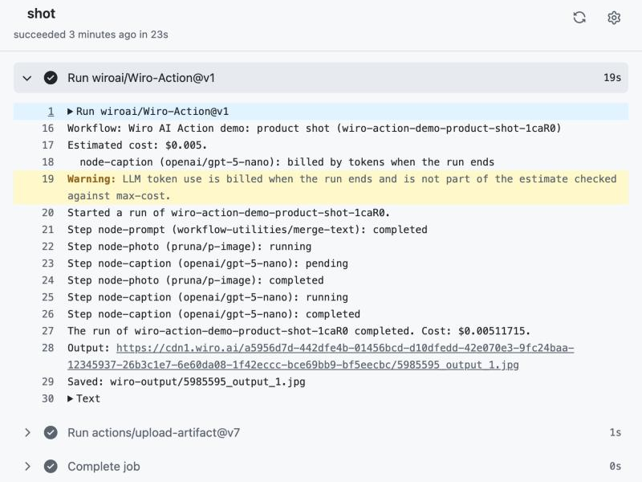
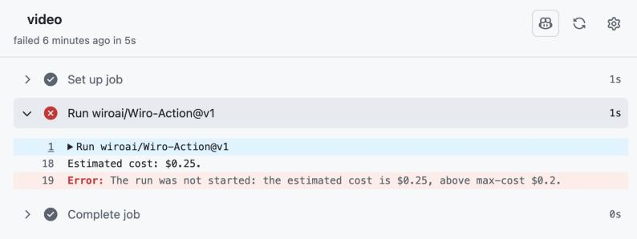
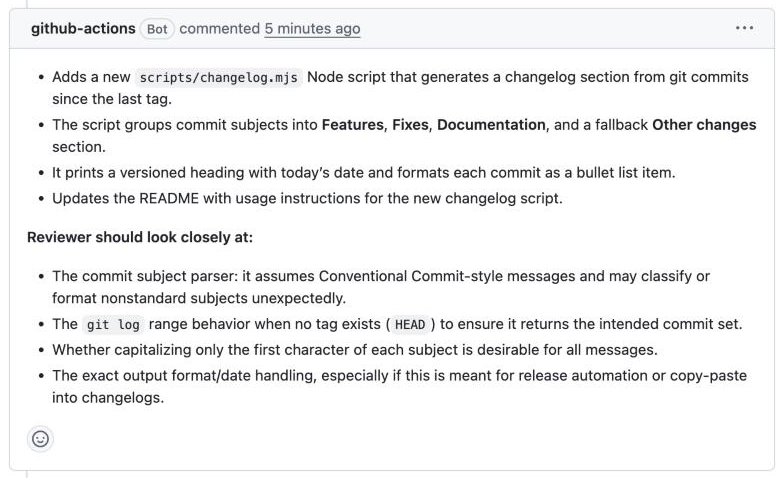
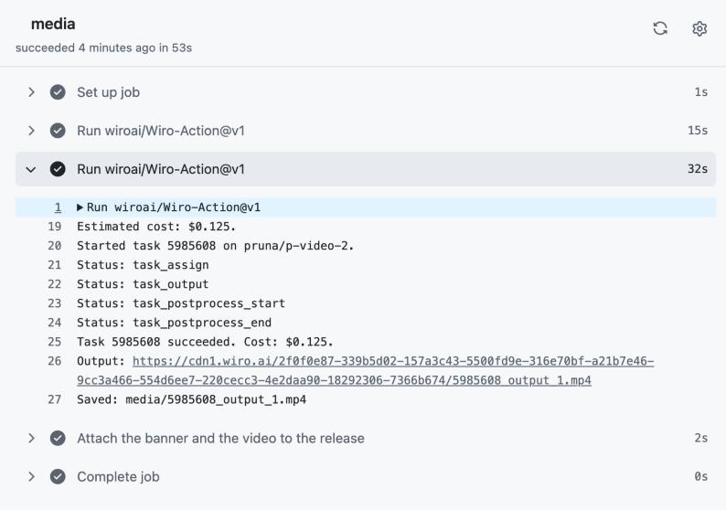

<div align="center">


# Wiro AI Action

Run Wiro AI models in GitHub Actions: generate images, video, audio and 3D with any of 1,000+ models, or ask an LLM about your code, and use the results in the next steps of your workflow.

[](https://github.com/wiroai/Wiro-Action/actions/workflows/ci.yml) [](./action.yml) [](./LICENSE)

[Website](https://wiro.ai) · [Models](https://wiro.ai/models) · [Docs](https://wiro.ai/docs) · [Dashboard](https://wiro.ai/panel)


</div>

`wiroai/Wiro-Action` calls the [Wiro AI](https://wiro.ai) API from a workflow step. It has three modes:

- **model** runs any model in the catalog, waits for the task to finish and gives you the output URLs, the text and the cost. It can upload files from the workspace as inputs and download the outputs.
- **workflow** runs one of your Wiro AI workflows, the chains of models you build on wiro.ai, with the inputs you give it, and returns what the workflow's End node shows.
- **llm** sends a prompt, with files if you like, to the Wiro AI LLM gateway and gives you the answer. The gateway speaks the OpenAI Chat Completions protocol.

In every mode the action estimates the price before it starts, and `max-cost` keeps a run from starting when the estimate is above your limit.

## Quick start

1. Create a project at [wiro.ai/panel/project/new](https://wiro.ai/panel/project/new) and copy its API key. If the project uses signature authentication, copy the API secret too.
2. In your repository, open **Settings → Secrets and variables → Actions** and add the key as `WIRO_API_KEY` (and the secret as `WIRO_API_SECRET`).
3. Add a step to a workflow:

```yaml
- uses: wiroai/Wiro-Action@v1
  id: image
  with:
    api-key: ${{ secrets.WIRO_API_KEY }}
    model: pruna/p-image
    prompt: A small paper boat on a calm lake at sunrise, soft light
    params: |
      aspectRatio: "16:9"
    download: true
```

The image lands in `wiro-output/`, and `steps.image.outputs.url` holds its URL.

## Model mode

Each model page on [wiro.ai/models](https://wiro.ai/models) shows the model ID (`owner/model`) and its parameters. Put the parameters in `params`, as YAML or JSON. `prompt` is a shortcut for the `prompt` parameter. A required parameter you leave out, such as an output format, gets the default the model's form on wiro.ai starts with, and the log says which ones; file inputs and the prompt are never filled in for you.

The action starts the run, checks the task every `poll-interval` seconds until it ends, and fails the step if the run fails. If `timeout` runs out or the workflow run is cancelled, it stops the task, so you don't pay for a result nobody reads. Set `cancel-on-timeout: false` to let it finish anyway. Only successful runs are billed, and the `cost` output tells you what a run cost.

LLMs run in model mode too, and their answer is in the `text` output. So is the text of models that return a text file, such as the transcript of a speech-to-text model.

### Local files as model inputs

Models that take images, audio, video or documents accept a public URL in `params`, or a file from the workspace through `files`. `files` maps each file parameter to a path:

```yaml
- uses: wiroai/Wiro-Action@v1
  with:
    api-key: ${{ secrets.WIRO_API_KEY }}
    model: wiro/remove-background
    files: |
      inputImage: assets/product.png
    download: true
```

The action reads the model's parameter list and uploads each file in the form that parameter expects. A parameter that takes several files accepts a list or a glob pattern.

## Workflow mode

Build a workflow on [wiro.ai/workflows](https://wiro.ai/workflows), then pass its link, or its full slug such as `product-ad-a1B2c`, in `workflow`. With `workflow` set, `mode` can be left out.

```yaml
- uses: wiroai/Wiro-Action@v1
  id: ad
  with:
    api-key: ${{ secrets.WIRO_API_KEY }}
    workflow: https://wiro.ai/workflows/product-ad-a1B2c
    params: |
      brief: A short ad for a reusable water bottle
    files: |
      product_photo: assets/bottle.png
    max-cost: '1.00'
    download: true
```

- `params` sets the workflow's inputs by the names its Start node shows. An input you leave out uses its saved value, then its default. The action checks the names and the required inputs before it starts.
- `files` uploads files from the workspace to your Wiro AI storage and passes their URLs as inputs.
- The action waits for the run and logs each step as it starts and ends. If a step fails, the action fails and names the step and the reason. When `timeout` runs out, the action stops waiting and fails; the run itself goes on, and its results appear on wiro.ai when it ends. Give long workflows a generous `timeout`.
- The `outputs` output is a JSON object with each result of the End node, by name. Files are also in `urls` and can be downloaded with `download: true`; texts, such as an LLM's answer, are in `text`.

The log of a real run of a three-step workflow:



## LLM mode

Set `mode: llm` and pick a model from the [LLM catalog](https://wiro.ai/models?categories=llm-tool-call). `files` takes paths or glob patterns, one per line:

- text files (code, diffs, Markdown, logs) are added to the message as text,
- PNG, JPEG, GIF and WebP images are sent as images,
- PDF documents are sent as files,

for models that read images and documents. `params` adds Chat Completions fields such as `max_tokens`, `reasoning_effort` or `response_format`.

```yaml
- uses: wiroai/Wiro-Action@v1
  id: review
  with:
    mode: llm
    api-key: ${{ secrets.WIRO_API_KEY }}
    model: openai/gpt-5-4-mini
    system: You are a careful code reviewer.
    prompt: List the three riskiest changes in this diff.
    files: pr.diff
```

## Cost limit

Before it starts, the action estimates the price, logs it and sets the `estimated-cost` output:

- **model mode:** the model's price for the settings you send, defaults included, as its page on wiro.ai shows it.
- **workflow mode:** the sum of those prices over the steps that lead to the End node, plus the creator's fee of a priced gallery workflow. For a workflow whose steps are hidden from you, the estimate Wiro AI gives.
- **llm mode:** an upper estimate from the model's prices per token, with the input counted from the prompt and files and the output from `max_tokens`, or from the model's output limit when `max_tokens` is not set.

Set `max-cost` to the most a run may cost, in USD. A run whose estimate is higher does not start. Neither does a run whose price is only known after it ends, such as a model billed by run time, because the action can't confirm it stays under the limit. LLM token use inside a model or workflow run is billed when the run ends: the action leaves it out of the estimate and says so in the log.

```yaml
- uses: wiroai/Wiro-Action@v1
  with:
    api-key: ${{ secrets.WIRO_API_KEY }}
    model: pruna/p-video-2
    prompt: The paper boat drifts across the lake as the sun comes up
    params: |
      duration: "10"
      resolution: 720p
    max-cost: '0.20' # this run is estimated at $0.25, so it does not start
```

The log of that run:



## Examples

Each example is a complete workflow file: copy it to `.github/workflows/` and add the `WIRO_API_KEY` secret.

### Summarize a pull request

```yaml
name: Pull request summary

on:
  pull_request:
    types: [opened, ready_for_review]

permissions:
  contents: read
  pull-requests: write

jobs:
  summary:
    # Pull requests from forks and from Dependabot don't receive repository secrets.
    if: github.event.pull_request.head.repo.full_name == github.repository && github.actor != 'dependabot[bot]'
    runs-on: ubuntu-latest
    steps:
      - uses: actions/checkout@v7
        with:
          fetch-depth: 0

      - name: Save the diff
        env:
          BASE: ${{ github.event.pull_request.base.sha }}
        run: git diff "$BASE" HEAD -- . ':!package-lock.json' > pr.diff

      - uses: wiroai/Wiro-Action@v1
        id: summary
        with:
          mode: llm
          api-key: ${{ secrets.WIRO_API_KEY }}
          model: openai/gpt-5-4-mini
          system: You write short, factual pull request summaries for reviewers.
          prompt: >-
            Summarize this pull request in at most five bullet points.
            Then list anything a reviewer should look at closely.
          files: pr.diff
          params: |
            reasoning_effort: low

      - name: Comment on the pull request
        env:
          GH_TOKEN: ${{ github.token }}
          PR: ${{ github.event.pull_request.number }}
          SUMMARY: ${{ steps.summary.outputs.text }}
        run: printf '%s\n' "$SUMMARY" | gh pr comment "$PR" --repo "$GITHUB_REPOSITORY" --body-file -
```

The comment it posted on a pull request in a real run:



### Write alt text for changed images

```yaml
name: Alt text

on:
  pull_request:
    paths: ['**.png', '**.jpg', '**.jpeg', '**.gif', '**.webp']

permissions:
  contents: read
  pull-requests: write

jobs:
  alt-text:
    # Pull requests from forks and from Dependabot don't receive repository secrets.
    if: github.event.pull_request.head.repo.full_name == github.repository && github.actor != 'dependabot[bot]'
    runs-on: ubuntu-latest
    steps:
      - uses: actions/checkout@v7
        with:
          fetch-depth: 0

      - name: Find the added and changed images
        id: changed
        env:
          BASE: ${{ github.event.pull_request.base.sha }}
        run: |
          {
            echo 'images<<EOF'
            git -c core.quotePath=false diff --name-only --diff-filter=AM "$BASE" HEAD -- \
              '*.png' '*.jpg' '*.jpeg' '*.gif' '*.webp'
            echo 'EOF'
          } >> "$GITHUB_OUTPUT"

      - uses: wiroai/Wiro-Action@v1
        id: alt
        if: steps.changed.outputs.images != ''
        with:
          mode: llm
          api-key: ${{ secrets.WIRO_API_KEY }}
          model: openai/gpt-5-4-mini
          prompt: >-
            Write alt text for each image above. Answer with one line per image,
            in the form `path`: alt text, and keep each one under 125 characters.
          files: ${{ steps.changed.outputs.images }}

      - name: Comment on the pull request
        if: steps.changed.outputs.images != ''
        env:
          GH_TOKEN: ${{ github.token }}
          PR: ${{ github.event.pull_request.number }}
          ALT_TEXT: ${{ steps.alt.outputs.text }}
        run: |
          printf '### Suggested alt text\n\n%s\n' "$ALT_TEXT" |
            gh pr comment "$PR" --repo "$GITHUB_REPOSITORY" --body-file -
```

### Make a release banner and a short video

The second step turns the banner into a five-second video, and `max-cost` keeps it from starting if the price is above $0.20.

```yaml
name: Release media

on:
  release:
    types: [published]

permissions:
  contents: write

jobs:
  media:
    runs-on: ubuntu-latest
    steps:
      - uses: wiroai/Wiro-Action@v1
        id: banner
        with:
          api-key: ${{ secrets.WIRO_API_KEY }}
          model: pruna/p-image
          prompt: >-
            A clean, wide banner for a software release named
            "${{ github.event.release.name }}", abstract shapes, soft light
          params: |
            aspectRatio: "16:9"
          download: true
          download-dir: media

      - uses: wiroai/Wiro-Action@v1
        id: video
        with:
          api-key: ${{ secrets.WIRO_API_KEY }}
          model: pruna/p-video-2
          prompt: Slow camera push in, the shapes drift and the light shifts gently
          params: |
            inputImage: ${{ steps.banner.outputs.url }}
            duration: "5"
            resolution: 720p
          max-cost: '0.20'
          timeout: 900
          download: true
          download-dir: media

      - name: Attach the banner and the video to the release
        env:
          GH_TOKEN: ${{ github.token }}
          TAG: ${{ github.event.release.tag_name }}
          BANNER: ${{ steps.banner.outputs.files }}
          VIDEO: ${{ steps.video.outputs.files }}
        run: |
          cp "$(jq -r '.[0]' <<< "$BANNER")" release-banner.jpg
          cp "$(jq -r '.[0]' <<< "$VIDEO")" release-video.mp4
          gh release upload "$TAG" release-banner.jpg release-video.mp4 --repo "$GITHUB_REPOSITORY"
```

The video step in a real run:



### Read the release notes aloud

An LLM turns the notes into a short script, a voice model reads it, and the MP3 goes on the release.

```yaml
name: Release notes audio

on:
  release:
    types: [published]

permissions:
  contents: write

jobs:
  narrate:
    if: github.event.release.body != ''
    runs-on: ubuntu-latest
    steps:
      - uses: wiroai/Wiro-Action@v1
        id: script
        with:
          mode: llm
          api-key: ${{ secrets.WIRO_API_KEY }}
          model: openai/gpt-5-4-mini
          system: >-
            You turn release notes into a script to be read aloud: plain sentences,
            no Markdown, no links, under 120 words.
          prompt: ${{ github.event.release.body }}
          params: |
            reasoning_effort: low

      - uses: wiroai/Wiro-Action@v1
        id: voice
        with:
          api-key: ${{ secrets.WIRO_API_KEY }}
          model: elevenlabs/eleven-v4-turbo
          prompt: ${{ steps.script.outputs.text }}
          params: |
            voice: alice
          max-cost: '0.10'
          download: true

      - name: Attach the audio to the release
        env:
          GH_TOKEN: ${{ github.token }}
          TAG: ${{ github.event.release.tag_name }}
          FILES: ${{ steps.voice.outputs.files }}
        run: |
          cp "$(jq -r '.[0]' <<< "$FILES")" release-notes.mp3
          gh release upload "$TAG" release-notes.mp3 --repo "$GITHUB_REPOSITORY"
```

### Translate the README in a pull request

Run it from the Actions tab and pick the language. Opening the pull request needs **Settings → Actions → General → Allow GitHub Actions to create and approve pull requests**.

```yaml
name: Translate the README

on:
  workflow_dispatch:
    inputs:
      language:
        description: The language to translate into
        default: Turkish
      code:
        description: The language code for the file name, as in README.tr.md
        default: tr

permissions:
  contents: write
  pull-requests: write

jobs:
  translate:
    runs-on: ubuntu-latest
    steps:
      - uses: actions/checkout@v7

      - uses: wiroai/Wiro-Action@v1
        id: translate
        with:
          mode: llm
          api-key: ${{ secrets.WIRO_API_KEY }}
          model: openai/gpt-5-4-mini
          system: >-
            You translate Markdown documents. Keep the Markdown, code blocks, links,
            HTML and product names as they are. Answer with the translated document only.
          prompt: Translate README.md into ${{ inputs.language }}.
          files: README.md
          params: |
            reasoning_effort: low
          max-cost: '0.50'

      - name: Open a pull request
        env:
          GH_TOKEN: ${{ github.token }}
          TRANSLATION: ${{ steps.translate.outputs.text }}
          LANGUAGE: ${{ inputs.language }}
          CODE: ${{ inputs.code }}
        run: |
          branch="translate-readme-$CODE-$GITHUB_RUN_ID"
          git switch -c "$branch"
          printf '%s\n' "$TRANSLATION" > "README.$CODE.md"
          git config user.name 'github-actions[bot]'
          git config user.email '41898282+github-actions[bot]@users.noreply.github.com'
          git add "README.$CODE.md"
          git commit -m "docs: translate the README into $LANGUAGE"
          git push origin "$branch"
          gh pr create --head "$branch" --title "Translate the README into $LANGUAGE" \
            --body "A $LANGUAGE translation of README.md, made with Wiro AI. Please read it through before merging."
```

### Make a social share card

```yaml
name: Social card

on:
  workflow_dispatch:
    inputs:
      title:
        description: The headline on the card
        required: true

jobs:
  card:
    runs-on: ubuntu-latest
    steps:
      - uses: wiroai/Wiro-Action@v1
        with:
          api-key: ${{ secrets.WIRO_API_KEY }}
          model: openai/gpt-image-2
          prompt: >-
            A clean social media card with the headline "${{ inputs.title }}" in large,
            bold type, plenty of white space and one simple abstract shape in a corner
          params: |
            ratio: "16:9"
            quality: medium
          max-cost: '0.05'
          download: true
          download-dir: card

      - uses: actions/upload-artifact@v7
        with:
          name: social-card
          path: card/
```

### Run one of your workflows

Replace the link with your own workflow's, and the input names with the ones its Start node shows.

```yaml
name: Product video

on:
  workflow_dispatch:
    inputs:
      brief:
        description: What the video should show
        required: true

jobs:
  video:
    runs-on: ubuntu-latest
    steps:
      - uses: actions/checkout@v7

      - uses: wiroai/Wiro-Action@v1
        with:
          api-key: ${{ secrets.WIRO_API_KEY }}
          workflow: https://wiro.ai/workflows/product-ad-a1B2c
          params: |
            brief: ${{ toJSON(inputs.brief) }}
          files: |
            product_photo: assets/product.png
          max-cost: '1.00'
          timeout: 1800
          download: true

      - uses: actions/upload-artifact@v7
        with:
          name: product-video
          path: wiro-output/
```

`toJSON()` writes free text as a quoted string, so quotes, colons and line breaks in it can't break the YAML of `params`.

## Inputs

| Input               | Default                  | Description                                                                                                                                                                                          |
| ------------------- | ------------------------ | ---------------------------------------------------------------------------------------------------------------------------------------------------------------------------------------------------- |
| `api-key`           |                          | **Required.** Your Wiro AI project API key. Keep it in a secret.                                                                                                                                     |
| `api-secret`        |                          | The project's API secret, for projects that use signature authentication.                                                                                                                            |
| `mode`              |                          | `model` runs a model and waits for the task. `workflow` runs one of your workflows. `llm` sends one chat request to the LLM gateway. When empty: `workflow` if `workflow` is set, otherwise `model`. |
| `model`             |                          | model and llm modes: the model ID, `owner/model`, for example `pruna/p-image` or `openai/gpt-5-4-mini`.                                                                                              |
| `workflow`          |                          | workflow mode: the workflow's link on wiro.ai, or its full slug, such as `product-ad-a1B2c`.                                                                                                         |
| `prompt`            |                          | llm mode: the message to send (required). model and workflow modes: sent as the `prompt` parameter or input.                                                                                         |
| `system`            |                          | llm mode: the system prompt.                                                                                                                                                                         |
| `params`            |                          | A JSON or YAML mapping. model mode: the model parameters. workflow mode: the workflow inputs. llm mode: extra Chat Completions fields.                                                               |
| `files`             |                          | model and workflow modes: a mapping of parameter or input name to a path, list or glob. llm mode: paths or glob patterns, one per line.                                                              |
| `max-cost`          |                          | The most a run may cost, in USD, such as `0.50`. A run whose estimate is higher, or whose price can't be confirmed under it, does not start.                                                         |
| `timeout`           | `600`                    | Seconds to wait for the result.                                                                                                                                                                      |
| `poll-interval`     | `3`                      | model and workflow modes: seconds between status checks.                                                                                                                                             |
| `cancel-on-timeout` | `true`                   | model mode: stop the task when `timeout` runs out or the workflow run is cancelled.                                                                                                                  |
| `download`          | `false`                  | model and workflow modes: download the output files.                                                                                                                                                 |
| `download-dir`      | `wiro-output`            | model and workflow modes: the folder for downloaded files, relative to the workspace.                                                                                                                |
| `summary`           | `true`                   | Write the result, with images and answers, to the job summary.                                                                                                                                       |
| `api-url`           | `https://api.wiro.ai/v1` | The Wiro AI API base URL.                                                                                                                                                                            |
| `llm-url`           | `https://llm.wiro.ai/v1` | The Wiro AI LLM gateway base URL.                                                                                                                                                                    |

Paths in `files` and `download-dir` are relative to the workspace. Patterns that start with `!` leave files out.

## Outputs

| Output           | Mode            | Description                                                                                                                                                                                                                |
| ---------------- | --------------- | -------------------------------------------------------------------------------------------------------------------------------------------------------------------------------------------------------------------------- |
| `task-id`        | model           | The Wiro AI task ID.                                                                                                                                                                                                       |
| `run-token`      | workflow        | The token of the workflow run. It is masked in the logs.                                                                                                                                                                   |
| `url`            | model, workflow | The URL of the first output file.                                                                                                                                                                                          |
| `urls`           | model, workflow | A JSON array with the URLs of all output files.                                                                                                                                                                            |
| `files`          | model, workflow | A JSON array with the downloaded file paths, relative to the workspace.                                                                                                                                                    |
| `outputs`        | model, workflow | model mode: the task's outputs as a JSON array of objects with `name`, `contenttype`, `size`, `url` and, for LLMs, `content`. workflow mode: a JSON object with each result of the End node, as a list of files and texts. |
| `text`           | all             | The text answer: the reply in llm mode. In model mode, the answer of an LLM, or the text file a model returns, such as a transcript. In workflow mode, the text results.                                                   |
| `cost`           | all             | The amount billed for the run, in USD.                                                                                                                                                                                     |
| `estimated-cost` | all             | The price estimated before the run, in USD; empty when it is not known before the run. In llm mode it is an upper estimate.                                                                                                |
| `response`       | llm             | The full Chat Completions response as JSON, for tool calls and other details.                                                                                                                                              |

Read JSON outputs with `fromJSON()` in expressions, for example `fromJSON(steps.image.outputs.urls)[0]`, or with `jq` in a script.

## Authentication

For an API key only project, `api-key` is all you need. For a project that uses signature authentication, also set `api-secret`: the action signs every API request with a fresh nonce and sends `key:secret` to the LLM gateway. See [Authentication](https://wiro.ai/docs/authentication) in the docs.

## Security

- Keep the key in a secret. The action also masks it in the logs.
- Treat model output as untrusted text. Pass it to scripts through `env:`, as the examples do, and don't write `${{ steps.<id>.outputs.text }}` inside a `run:` script. See [Security hardening for GitHub Actions](https://docs.github.com/en/actions/security-for-github-actions/security-guides/security-hardening-for-github-actions).
- Workflows started by pull requests from forks, or by Dependabot, don't receive repository secrets, so the action would stop there with an empty `api-key`. The pull request examples skip those runs with an `if:` condition on the job.
- The action prints model answers to the log with workflow commands turned off, so a line such as `::error::` in an answer stays plain text.

## Self-hosted runners behind a proxy

Set `NODE_USE_ENV_PROXY: 1` next to `HTTPS_PROXY` in the job's `env`, and Node.js sends the action's requests through the proxy. See [Enterprise network configuration](https://nodejs.org/en/learn/http/enterprise-network-configuration) in the Node.js docs.

## Agent skill

This repository includes an agent skill, `wiro-github-action`, in [`skills/wiro-github-action/SKILL.md`](./skills/wiro-github-action/SKILL.md). It shows coding agents such as Claude Code and Cursor how to write workflows with this action: pick the mode and the model, read the key from a secret, set a cost limit and use the results in later steps. Add it to your agent with:

```bash
npx skills add wiroai/Wiro-Action --skill wiro-github-action
```

## Development

```bash
npm ci
npm run build   # bundles src/ into dist/index.js
npm test        # unit tests, and dist/index.js against a mock API
npm run lint
```

`dist/` is committed, because GitHub runs the action from the repository. Run `npm run build` and commit `dist/` with every change; CI checks that it matches the source. The CI workflow also runs the action against the mock API in `test/mock-server.js`, and runs a live test when the repository has a `WIRO_API_KEY` secret.

To release, update the version in `package.json` and `src/version.js` and the [changelog](./CHANGELOG.md), tag the commit `vX.Y.Z`, move the `v1` tag to the same commit, and publish a GitHub release for `vX.Y.Z` with **Publish this Action to the GitHub Marketplace** ticked.

## More from Wiro AI

| Repository                                                                   | What it is                                                                                                                                              |
| ---------------------------------------------------------------------------- | ------------------------------------------------------------------------------------------------------------------------------------------------------- |
| [Wiro-MCP](https://github.com/wiroai/Wiro-MCP)                               | Official MCP server for Wiro AI, [`@wiro-ai/wiro-mcp` on npm](https://www.npmjs.com/package/@wiro-ai/wiro-mcp)                                          |
| [Wiro-LLM](https://github.com/wiroai/Wiro-LLM)                               | Vercel AI SDK provider for chat, images, speech, transcription and video, [`@wiro-ai/wiro-llm` on npm](https://www.npmjs.com/package/@wiro-ai/wiro-llm) |
| [Wiro-Plugin](https://github.com/wiroai/Wiro-Plugin)                         | Wiro AI plugin for Cursor, Claude Code, Gemini CLI, Devin, Antigravity and Kiro                                                                         |
| [Wiro-Skills](https://github.com/wiroai/Wiro-Skills)                         | Agent skills for images, image edits, video, music, speech, transcripts, 3D and model search                                                            |
| [Wiro-Chromium-Extension](https://github.com/wiroai/Wiro-Chromium-Extension) | Wiro AI extension for Chrome, Edge, Opera and Brave                                                                                                     |
| [Wiro-Firefox-Extension](https://github.com/wiroai/Wiro-Firefox-Extension)   | Wiro AI add-on for Firefox                                                                                                                              |
| [Wiro-Safari-Extension](https://github.com/wiroai/Wiro-Safari-Extension)     | Wiro AI extension for Safari on the Mac                                                                                                                 |
| [Swift-QuickStart](https://github.com/wiroai/Swift-QuickStart)               | WiroKit, the Wiro AI SDK for iOS                                                                                                                        |
| [Kotlin-QuickStart](https://github.com/wiroai/Kotlin-QuickStart)             | WiroKit, the Wiro AI SDK for Android                                                                                                                    |
| [Dart-QuickStart](https://github.com/wiroai/Dart-QuickStart)                 | Wiro AI SDK for Dart and Flutter, [`wiro` on pub.dev](https://pub.dev/packages/wiro)                                                                    |
| [ReactNative-QuickStart](https://github.com/wiroai/ReactNative-QuickStart)   | Wiro AI SDK for React Native and Expo, [`@wiro-ai/wiro-react-native` on npm](https://www.npmjs.com/package/@wiro-ai/wiro-react-native)                  |
| [Swift-Realtime](https://github.com/wiroai/Swift-Realtime)                   | Realtime voice AI example for iOS                                                                                                                       |
| [Kotlin-Realtime](https://github.com/wiroai/Kotlin-Realtime)                 | Realtime voice AI example for Android                                                                                                                   |
| [Dart-Realtime](https://github.com/wiroai/Dart-Realtime)                     | Realtime voice AI example for Flutter                                                                                                                   |
| [ReactNative-Realtime](https://github.com/wiroai/ReactNative-Realtime)       | Realtime voice AI example for React Native                                                                                                              |
| [n8n-nodes-wiroai](https://github.com/wiroai/n8n-nodes-wiroai)               | Wiro AI nodes for n8n, [`@wiro-ai/n8n-nodes-wiroai` on npm](https://www.npmjs.com/package/@wiro-ai/n8n-nodes-wiroai)                                    |
| [Wiro-Dify-Plugin](https://github.com/wiroai/Wiro-Dify-Plugin)               | Wiro AI plugins for Dify: the LLM gateway as a model provider, plus image, video, speech and music tools                                                |
| [Wiro-ComfyUI](https://github.com/wiroai/Wiro-ComfyUI)                       | Wiro AI nodes for ComfyUI                                                                                                                               |
| [Wiro-Hermes](https://github.com/wiroai/Wiro-Hermes)                         | Wiro AI plugins for Hermes Agent: image, video, audio and 3D tools, plus the LLM gateway as a model provider                                            |
| [Wiro-Zed](https://github.com/wiroai/Wiro-Zed)                               | Wiro AI MCP server extension for Zed                                                                                                                    |
| [Wiro-Raycast](https://github.com/wiroai/Wiro-Raycast)                       | Wiro AI extension for Raycast: image and video generation, LLM chat and model search                                                                    |
| [Wiro-WordPress](https://github.com/wiroai/Wiro-WordPress)                   | Wiro AI plugin for WordPress: featured images, image edits, alt text, narration and SEO suggestions                                                     |
| [Wiro-Obsidian](https://github.com/wiroai/Wiro-Obsidian)                     | Wiro AI plugin for Obsidian: images, video, speech, music, transcription and text tools                                                                 |
| [Wiro-Blender](https://github.com/wiroai/Wiro-Blender)                       | Wiro AI add-on for Blender: text to 3D, image to 3D and textures                                                                                        |
| [Wiro-Figma](https://github.com/wiroai/Wiro-Figma)                           | Wiro AI plugin for Figma: images, vectors, image edits and text                                                                                         |
| [Wiro-Next-Starter](https://github.com/wiroai/Wiro-Next-Starter)             | Next.js starter for Wiro AI: Playground, image, video and audio tools, and LLM chat, ready for Vercel and Railway                                       |
| [Wiro-Docs](https://github.com/wiroai/Wiro-Docs)                             | Source of the Wiro AI API docs                                                                                                                          |

[Website](https://wiro.ai) · [Models](https://wiro.ai/models) · [Docs](https://wiro.ai/docs) · [X](https://x.com/wiroai)

## License

MIT, see [LICENSE](./LICENSE).
